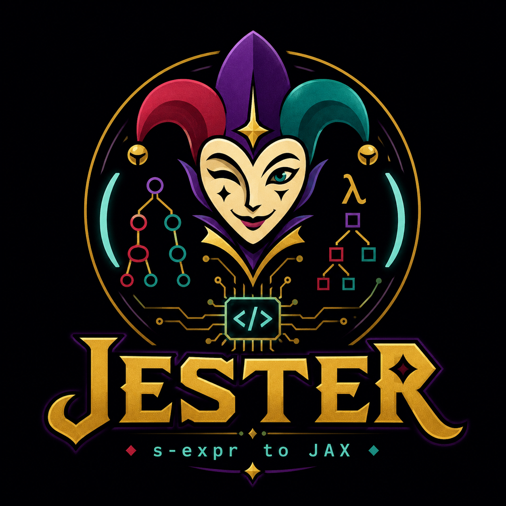

<p align="center">
    
</p>

# Jester

Jester[^1] is a small experimental language for defining classical density
functionals and evaluating them with JAX. This means the computations
run either on the CPU or GPU, and can be automatically differentiated.

It currently supports Rosenfeld fundamental measure theory on a three-dimensional
Fourier grid, though White Bear will soon be implemented as well.

## Running an example

The project uses [uv](https://docs.astral.sh/uv/) to manage dependencies.

```bash
uv sync
uv run python -m examples.hard_wall
```

Under Nix, either activate a shell where your GPU is visible or set the path
```bash
LD_LIBRARY_PATH=/run/opengl-driver/lib \
  uv run -m examples.hard_wall
```
The plot is written to wall_profile.pdf.

## Functional definitions

Functionals are written as S-expressions. For example:

```lisp
(functional rosenfeld
(dimension 3)

(species
    (rho 0.5))

(weighted-densities
    (n0 (fmt-weighted-density scalar-0))
    (n3 (fmt-weighted-density scalar-3)))

(free-energy-density
    (* (- 1) n0 (log (- 1 n3)))))
```

See examples/rosenfeld.dft (examples/rosenfeld.dft) for the complete
Rosenfeld functional.

## Status

Jester is an early-stage research project. Its language and Python API may
change.

## TODO

- Implement White Bear functional
- Add support for multiple species
- Add support for 2D and 1D functionals

[^1]: I chose the name becuse I like Balatro and it slightly sounds like JAX and S-Expression.